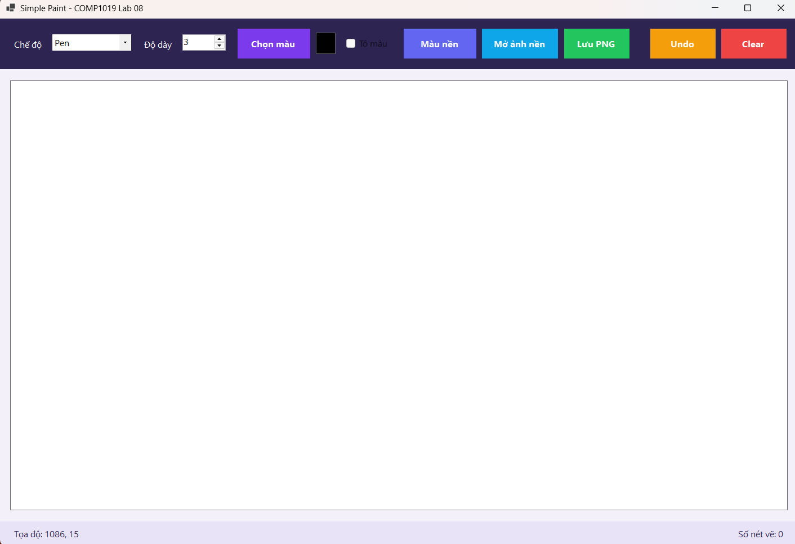
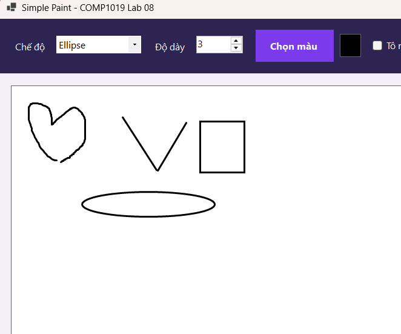
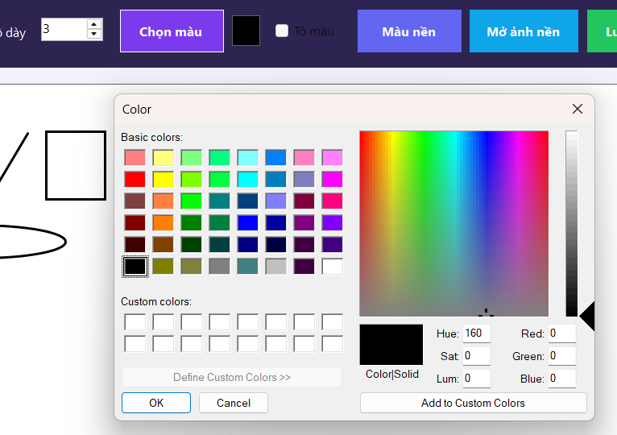
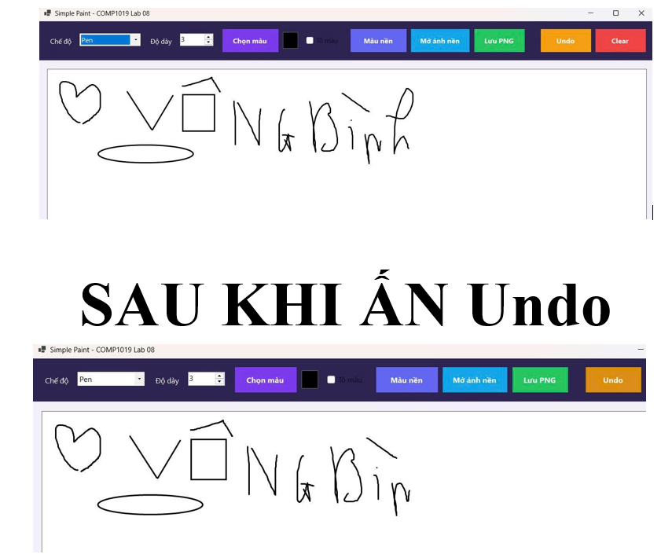
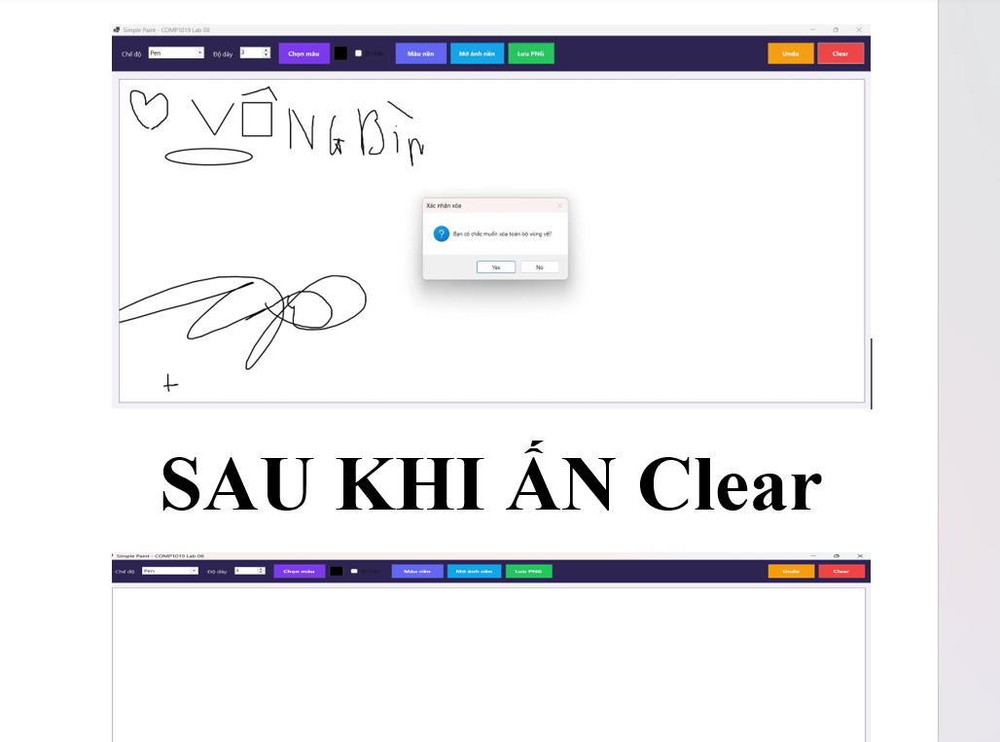
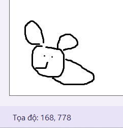
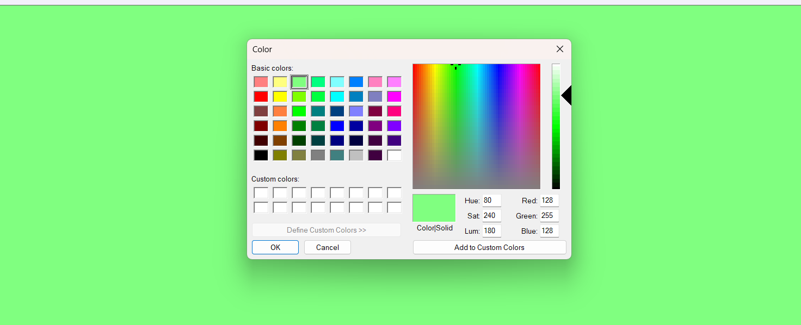
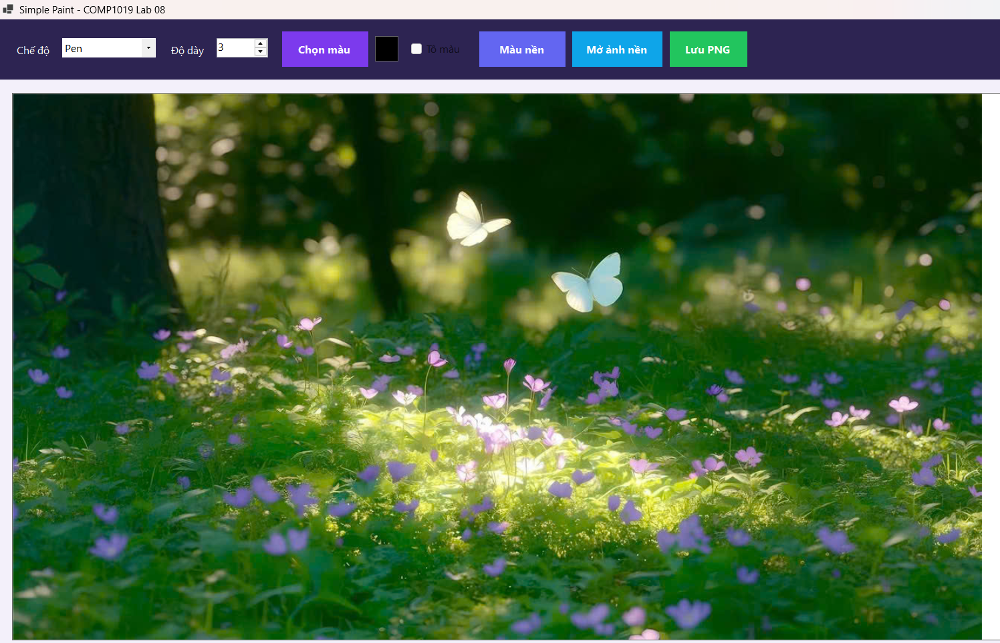
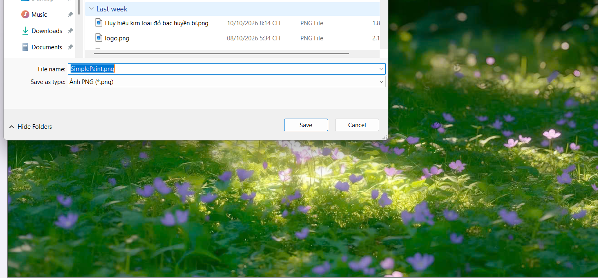

# BÁO CÁO THỰC HÀNH BUỔI 8: XÂY DỰNG ỨNG DỤNG PAINT ĐƠN GIẢN BẰNG WINFORMS VÀ GDI+

* **Học phần:** 2611COMP101904 - Lập trình trên Windows
* **Giảng viên hướng dẫn:** ThS. Lê Thanh Thoại
* **Sinh viên thực hiện:** Ngô Minh Hải
* **Môi trường phát triển:** Microsoft Visual Studio - C# Windows Forms App (.NET)
* **Tên ứng dụng:** SimplePaint 

---

## 1. Giới thiệu và Mục tiêu Kỹ thuật

Dự án `SimplePaint` được thiết kế nhằm xây dựng phần mềm vẽ đồ họa tương tác 2D trên nền tảng .NET Windows Forms kết hợp thư viện đồ họa GDI+ (Graphics Device Interface Plus):

* **Mô hình Quản lý Thực thể Vẽ (Object-Retained Rendering):** Không vẽ trực tiếp "chết" lên màn hình trong sự kiện chuột rồi bỏ qua dữ liệu. Ứng dụng tổ chức danh sách lưu vết đối tượng `List<DrawItem>`, bảo đảm toàn bộ hình vẽ không bị biến mất khi Form bị che khuất, thu nhỏ hoặc thay đổi kích thước (Resize).
* **Cơ chế Vẽ lại Tối ưu (Paint Event & Invalidation):** Mọi thao tác hiển thị đều được tập trung xử lý trong sự kiện `canvas_Paint`. Mỗi khi có sự thay đổi dữ liệu hoặc rê chuột tương tác, lệnh `canvas.Invalidate()` được kích hoạt để yêu cầu hệ điều hành vẽ lại mượt mà.
* **Xử lý Tương tác Chuột Toàn diện (Mouse Events Handling):** Kết hợp nhịp nhàng chuỗi sự kiện `MouseDown` (bắt đầu nét vẽ/ghi nhận điểm gốc), `MouseMove` (vẽ tự do hoặc preview khung hình tương tác theo thời gian thực), và `MouseUp` (chốt hình vẽ, đóng gói vào `DrawItem` và đưa vào danh sách).
* **Quản lý Tài nguyên Đồ họa An toàn (Resource Management):** Các đối tượng đồ họa không quản lý (`Pen`, `SolidBrush`, `Graphics`) đều được giải phóng triệt để bằng cấu trúc `using` hoặc phương thức `Dispose()`, tránh rò rỉ bộ nhớ hệ thống.
* **Mở rộng Tính năng Nâng cao:** Hỗ trợ lưu bản vẽ ra tệp ảnh PNG, chọn ảnh nền tùy chỉnh từ máy tính để vẽ đè, hoàn tác nét vẽ (Undo) và đổi màu nền canvas linh hoạt.

---

## 2. Đặc tả Cấu trúc Dữ liệu và Thành phần Điều khiển

### 2.1. Lớp Đối tượng Đồ họa (`DrawItem`)
Lớp đối tượng lưu trữ thông tin thuộc tính của từng nét vẽ trong danh sách `List<DrawItem>`:

| Thuộc tính | Kiểu dữ liệu | Ý nghĩa |
| :--- | :--- | :--- |
| `Mode` | `DrawMode` / `string` | Chế độ vẽ: `Pen`, `Line`, `Rectangle`, `Ellipse`. |
| `Color` | `Color` | Màu sắc của nét vẽ được chọn từ `ColorDialog`. |
| `Width` | `float` | Độ dày đường nét (giá trị từ 1 đến 20 từ `NumericUpDown`). |
| `StartPoint` | `Point` | Điểm tọa độ bắt đầu khi nhấn chuột (`MouseDown`). |
| `EndPoint` | `Point` | Điểm tọa độ kết thúc khi nhả chuột (`MouseUp`). |
| `Points` | `List<Point>` | Danh sách các tọa độ điểm liên tiếp dành riêng cho nét tự do (`Pen`). |

### 2.2. Danh mục Thành phần Điều khiển (Controls)
* `cboMode`: Hộp chọn chế độ vẽ (`Pen`, `Line`, `Rectangle`, `Ellipse`).
* `nudWidth`: Hộp chọn độ dày nét vẽ (giới hạn từ 1 đến 20).
* `btnColor`: Nút mở hộp thoại `ColorDialog` để chọn màu vẽ.
* `btnUndo`: Nút hoàn tác (xóa nét vẽ gần nhất).
* `btnClear`: Nút xóa sạch toàn bộ các nét vẽ trên vùng canvas.
* `canvas`: Vùng bề mặt vẽ chính (Panel/Custom Panel có nền trắng).
* `lblStatus`: Nhãn hiển thị tọa độ chuột theo thời gian thực (`X: ..., Y: ...`).

---

## 3. Minh chứng Thực nghiệm và Kiểm thử Chức năng (Test Cases)

Hệ thống đã trải qua quá trình kiểm thử toàn diện các trường hợp sử dụng, ghi nhận kết quả thực tế qua 9 ảnh minh chứng:

### 3.1. Khởi tạo Giao diện Ứng dụng
Giao diện trực quan với đầy đủ thanh công cụ điều khiển, hộp chọn chế độ, độ dày nét, các nút chức năng và vùng canvas màu trắng:

### 3.2. Vẽ thử nghiệm Đủ 4 Loại Hình
Chứng minh khả năng dựng hình chính xác của 4 chế độ vẽ bắt buộc: Nét tự do (`Pen`), Đoạn thẳng (`Line`), Hình chữ nhật (`Rectangle`) và Hình elip (`Ellipse`):

### 3.3. Tương tác Chọn Bảng màu (ColorDialog)
Hộp thoại `ColorDialog` cho phép người dùng tùy chọn bảng màu trực quan và cập nhật màu vẽ cho các nét tiếp theo:

### 3.4. Chức năng Hoàn tác Nét vẽ (Undo)
Cơ chế xóa phần tử cuối cùng trong `List<DrawItem>` và làm mới canvas, hỗ trợ người dùng rút lại nét vẽ vừa thực hiện:

### 3.5. Xóa Toàn bộ Vùng vẽ (Clear Canvas)
Làm sạch hoàn toàn các nét vẽ trên canvas, dọn dẹp bộ nhớ danh sách nét vẽ về trạng thái ban đầu:

### 3.6. Theo dõi Tọa độ Chuột Thời gian thực
Thanh trạng thái `lblStatus` liên tục cập nhật và hiển thị tọa độ vị trí con trỏ chuột (`X`, `Y`) khi di chuyển trên bề mặt canvas:

### 3.7. Thay đổi Màu nền Canvas (Tính năng nâng cao)
Cho phép người dùng linh hoạt đổi màu phông nền của vùng vẽ theo nhu cầu sáng tạo:

### 3.8. Tùy chọn Nạp Ảnh nền từ Máy tính (Tính năng nâng cao)
Hỗ trợ nạp tệp hình ảnh từ bộ nhớ máy tính để làm nền và vẽ đè các nét GDI+ lên trên ảnh gốc:

### 3.9. Xuất Bản vẽ ra Tệp Ảnh PNG (Tính năng nâng cao)
Chức năng lưu toàn bộ nội dung đồ họa trên canvas thành file hình ảnh định dạng PNG chất lượng cao vào bộ nhớ máy tính:

---

## 4. Hướng dẫn Biên dịch và Chạy Ứng dụng

1. **Khởi động:** Mở tệp giải pháp `COMP1019_Lab08_SimplePaint.sln` bằng Microsoft Visual Studio 2022 trở lên.
2. **Biên dịch:** Nhấn phím tắt `Ctrl + Shift + B` để build toàn bộ project ở chế độ `Debug` hoặc `Release`.
3. **Khởi chạy:** Nhấn `F5` (hoặc click nút **Start**) để khởi chạy phần mềm.
4. **Thao tác vẽ:**
   * Chọn chế độ hình vẽ trên ComboBox `cboMode`.
   * Tùy chỉnh độ dày tại `nudWidth` và chọn màu vẽ tại nút `btnColor`.
   * Nhấp và giữ chuột trái trên vùng `canvas` để vẽ; rê chuột theo ý muốn và nhả chuột để hoàn tất nét vẽ.
   * Sử dụng nút **Undo** để xóa nét vẽ vừa tạo, hoặc nút **Clear** để làm mới lại canvas.
