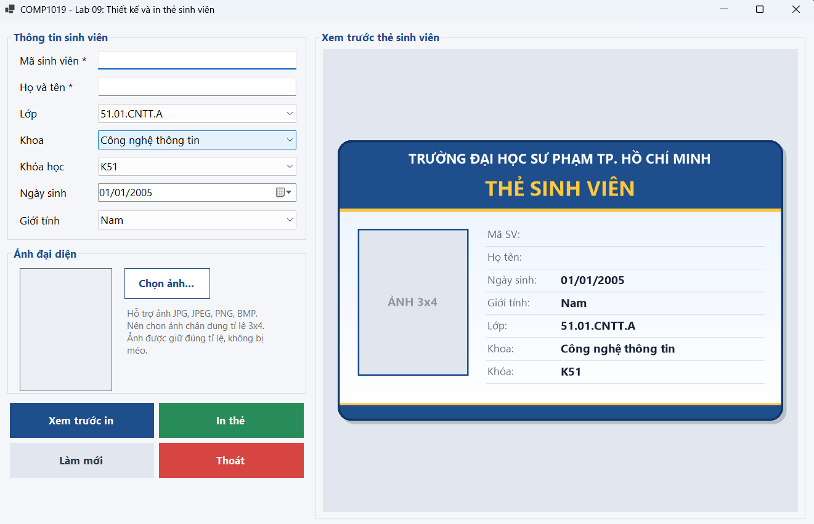
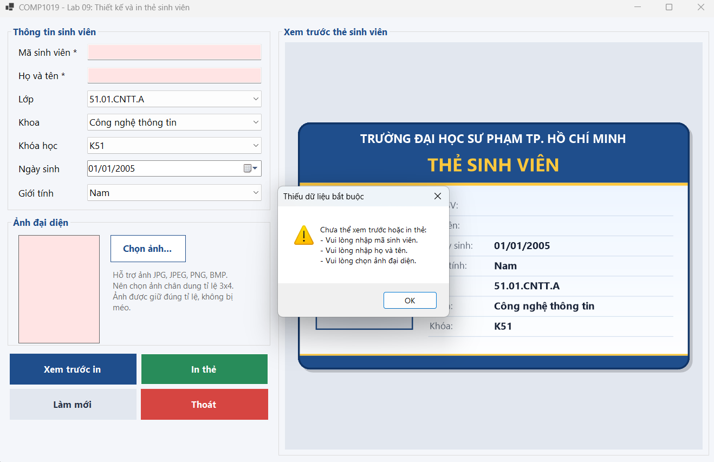
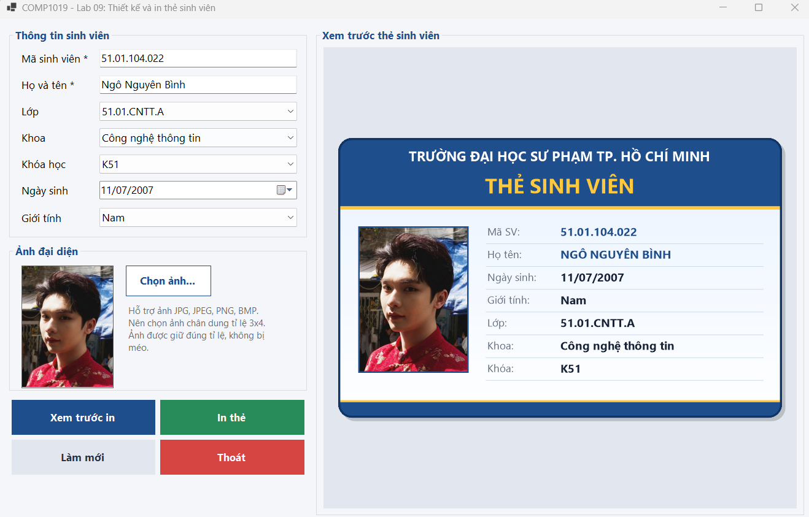
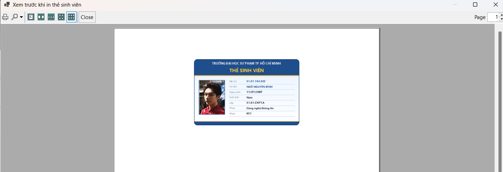
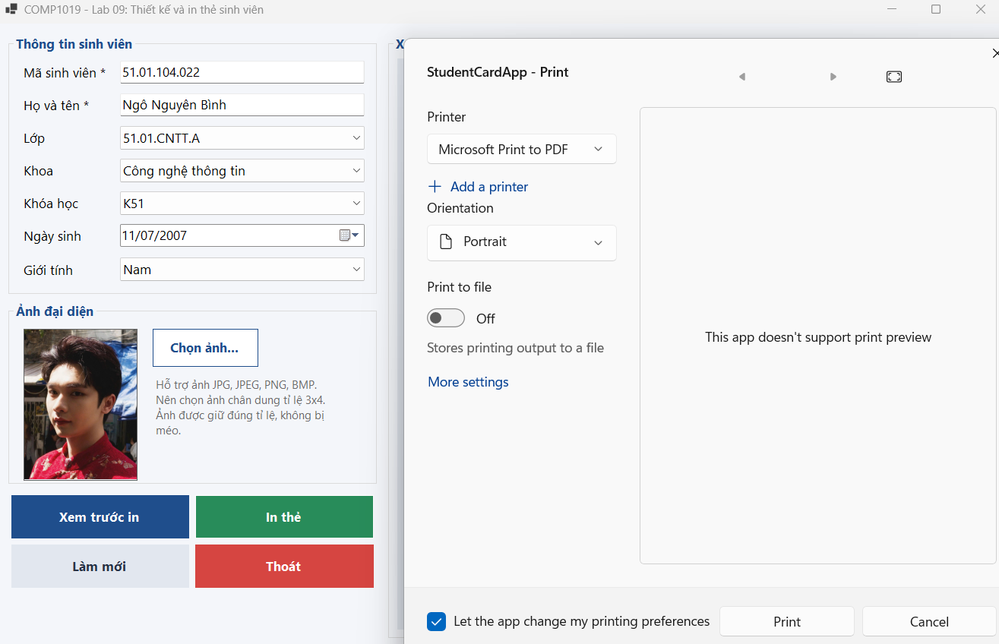

\# BÁO CÁO THỰC HÀNH BUỔI 9: THIẾT KẾ VÀ IN THẺ SINH VIÊN BẰNG C# WINFORMS VÀ GDI+

* **Học phần:** 2611COMP101904 - Lập trình trên Windows
* **Giảng viên hướng dẫn:** ThS. Lê Thanh Thoại
* **Sinh viên thực hiện:** Ngô Minh Hải
* **Môi trường phát triển:** Microsoft Visual Studio - C# Windows Forms App (.NET)
* **Tên Form chính:** FrmStudentCard

---

## 1. Giới thiệu và Kiến trúc Kỹ thuật

Ứng dụng `FrmStudentCard` được thiết kế nhằm phục vụ việc tiếp nhận thông tin sinh viên, trực quan hóa mẫu thẻ sinh viên tiêu chuẩn bằng kỹ thuật đồ họa 2D GDI+ và xuất bản in trực tiếp thông qua hệ thống điều khiển in ấn của Windows Forms:

* **Phân vùng Giao diện Hợp lý (Split-view Interface):**
  * **Nửa trái (Input Panel):** Tiếp nhận thông tin hồ sơ sinh viên (`TextBox`, `ComboBox`, `DateTimePicker`), tích hợp vùng chọn ảnh đại diện (`PictureBox`, `Button`, `OpenFileDialog`).
  * **Nửa phải (Preview Canvas):** Sử dụng `Panel` chuyên dụng để render đồ họa thẻ sinh viên theo thời gian thực dựa trên sự kiện `Paint`.
* **Kỹ thuật Đồ họa GDI+ & Cơ chế Dùng chung (Reusable Card Rendering):**
  * Xây dựng hàm kết xuất đồ họa dùng chung: `DrawCard(Graphics g, Rectangle bounds)` để tái sử dụng xuyên suốt giữa việc hiển thị xem trước trên `Panel` và in thực tế trên trang giấy thông qua `PrintDocument.PrintPage`. Điều này bảo đảm tỷ lệ, màu sắc, font chữ và độ phân giải đồng nhất 100%.
* **Xử lý Ảnh Đại diện An toàn (Non-locking Image Loading & Aspect Ratio):**
  * Sử dụng thuộc tính `PictureBoxSizeMode.Zoom` để giữ nguyên tỷ lệ khung hình chuẩn của ảnh thẻ sinh viên, tránh hiện tượng méo hoặc biến dạng tỷ lệ gốc.
  * Bộ lọc `OpenFileDialog.Filter` giới hạn nghiêm ngặt các định dạng ảnh hợp lệ: `*.jpg`, `*.jpeg`, `*.png`, `*.bmp`.
* **Quy trình Xác thực Đầu vào (Input Validation):**
  * Kiểm tra chặt chẽ các trường bắt buộc (Mã sinh viên, Họ tên, Ảnh đại diện) trước khi cho phép kích hoạt các chức năng in ấn hoặc xem trước.
* **Tích hợp Bộ Điều khiển In ấn (Printing Component Flow):**
  * Kết hợp bộ ba điều khiển tiêu chuẩn của .NET: `PrintDocument` (định nghĩa nội dung trang in), `PrintPreviewDialog` (màn hình trực quan hóa trang giấy in), và `PrintDialog` (hộp thoại lựa chọn thiết bị in ấn).

---

## 2. Đặc tả Thành phần Điều khiển và Thuộc tính

| Nhóm chức năng | Tên Control gợi ý | Loại Control | Mô tả vai trò |
| :--- | :--- | :--- | :--- |
| **Nhập liệu** | `txtMaSV` | `TextBox` | Nhập mã định danh sinh viên (Bắt buộc) |
| | `txtHoTen` | `TextBox` | Nhập họ và tên sinh viên (Bắt buộc) |
| | `cboLop` | `ComboBox` | Danh sách lựa chọn lớp sinh hoạt |
| | `cboKhoa` | `ComboBox` | Danh sách các khoa chuyên môn |
| | `txtKhoaHoc` | `TextBox` / `ComboBox` | Niên khóa đào tạo (ví dụ: K49, K50, K51) |
| | `dtpNgaySinh` | `DateTimePicker` | Lựa chọn ngày/tháng/năm sinh theo chuẩn |
| | `cboGioiTinh` | `ComboBox` | Phân loại giới tính (Nam / Nữ / Khác) |
| **Ảnh đại diện**| `picAvatar` | `PictureBox` | Hiển thị chân dung sinh viên (`SizeMode = Zoom`) |
| | `btnChonAnh` | `Button` | Kích hoạt `OpenFileDialog` để nạp tệp ảnh |
| **Trực quan hóa**| `pnlPreview` | `Panel` | Vùng vẽ đồ họa thẻ sinh viên qua sự kiện `Paint` |
| **Điều khiển** | `btnLamMoi` | `Button` | Làm sạch toàn bộ dữ liệu form và ảnh |
| | `btnXemTruoc` | `Button` | Kích hoạt `PrintPreviewDialog` |
| | `btnInThe` | `Button` | Kích hoạt `PrintDialog` và gửi lệnh in |
| | `btnThoat` | `Button` | Đóng và giải phóng tài nguyên ứng dụng |

---

## 3. Bảng Đặc tả 8 Test Cases Kiểm thử Ứng dụng

Theo quy chuẩn đánh giá của đề bài, hệ thống đã thực hiện tự kiểm thử 8 kịch bản chức năng:

| Mã TC | Tên Kịch bản Kiểm thử | Thao tác Thực hiện (Input) | Kết quả Mong đợi (Expected Output) | Trạng thái |
| :--- | :--- | :--- | :--- | :--- |
| **TC01** | Khởi tạo giao diện ban đầu | Khởi chạy chương trình `FrmStudentCard`. | Giao diện nạp đầy đủ các control, vùng nhập liệu rỗng, `PictureBox` và `Panel` ở trạng thái mặc định sạch sẽ. | **PASS** |
| **TC02** | Bẫy lỗi thiếu thông tin bắt buộc | Để trống Mã SV / Họ tên / Ảnh rồi bấm nút Xem trước hoặc In. | Kích hoạt `MessageBox` cảnh báo, yêu cầu nhập đầy đủ các trường bắt buộc; chặn không cho mở in ấn. | **PASS** |
| **TC03** | Chọn ảnh đại diện từ máy tính | Bấm nút Chọn ảnh, chọn một tệp hình ảnh (`.png`/`.jpg`). | Hộp thoại `OpenFileDialog` chỉ lọc file ảnh hợp lệ; ảnh nạp vào `PictureBox` hiển thị trọn vẹn, không bị méo. | **PASS** |
| **TC04** | Trực quan hóa thẻ bằng GDI+ | Điền đầy đủ thông tin hồ sơ và nạp ảnh thành công. | Vùng `pnlPreview` tự động vẽ khung thẻ sinh viên sắc nét: viền bo, tên trường, ảnh thẻ bên trái, thông tin bên phải. | **PASS** |
| **TC05** | Xem trước bản in (Print Preview) | Bấm nút "Xem trước in". | Hộp thoại `PrintPreviewDialog` xuất hiện, hiển thị trang giấy in có hình ảnh thẻ sinh viên đúng tỷ lệ chuẩn. | **PASS** |
| **TC06** | Chọn thiết bị in ấn (PrintDialog) | Bấm nút "In thẻ". | Mở hộp thoại `PrintDialog` cho phép chọn máy in (Microsoft Print to PDF / máy in văn phòng) và số lượng bản in. | **PASS** |
| **TC07** | Làm mới dữ liệu form (Clear/Reset) | Bấm nút "Làm mới" sau khi đã điền thông tin và nạp ảnh. | Toàn bộ các ô nhập liệu được xóa trống, ảnh thẻ bị gỡ bỏ, vùng `Panel` preview được vẽ lại về trạng thái ban đầu. | **PASS** |
| **TC08** | Kiểm tra thay đổi dữ liệu liên tục | Đổi ảnh đại diện khác hoặc chỉnh sửa Họ tên, Khóa học. | Hệ thống cập nhật lại vùng vẽ `pnlPreview` ngay lập tức, không gây rò rỉ bộ nhớ hoặc khóa file ảnh trên ổ đĩa. | **PASS** |

---

## 4. Minh chứng Thực nghiệm và Kiểm thử Hệ thống

Dưới đây là các hình ảnh minh chứng thực tế được trích xuất từ quá trình kiểm thử phần mềm:

### 4.1. Khởi tạo Giao diện Ban đầu (TC01)
Toàn bộ form giao diện `FrmStudentCard` khi vừa khởi chạy với phân vùng nhập liệu bên trái và khung xem trước bên phải:

### 4.2. Kiểm tra Bẫy lỗi Nhập liệu Thiếu Dữ liệu (TC02)
Hộp thoại cảnh báo kích hoạt khi người dùng chưa cung cấp đủ dữ liệu bắt buộc (Mã sinh viên, Họ tên, Ảnh thẻ) trước khi thực hiện in:

### 4.3. Kết xuất Đồ họa Thẻ Sinh viên bằng GDI+ (TC03, TC04, TC08)
Sau khi nhập đầy đủ thông tin và nạp ảnh chân dung, vùng xem trước `pnlPreview` vẽ hoàn chỉnh mẫu thẻ sinh viên tiêu chuẩn:

### 4.4. Xem trước Trang in Thực tế với PrintPreviewDialog (TC05)
Cửa sổ `PrintPreviewDialog` trực quan hóa chính xác vị trí và độ nét của thẻ sinh viên trên khổ giấy in trước khi xuất lệnh in:

### 4.5. Hộp thoại Điều khiển In ấn PrintDialog (TC06)
Cửa sổ cấu hình máy in `PrintDialog` hỗ trợ người dùng lựa chọn máy in thực tế hoặc xuất sang máy in ảo (Microsoft Print to PDF):

