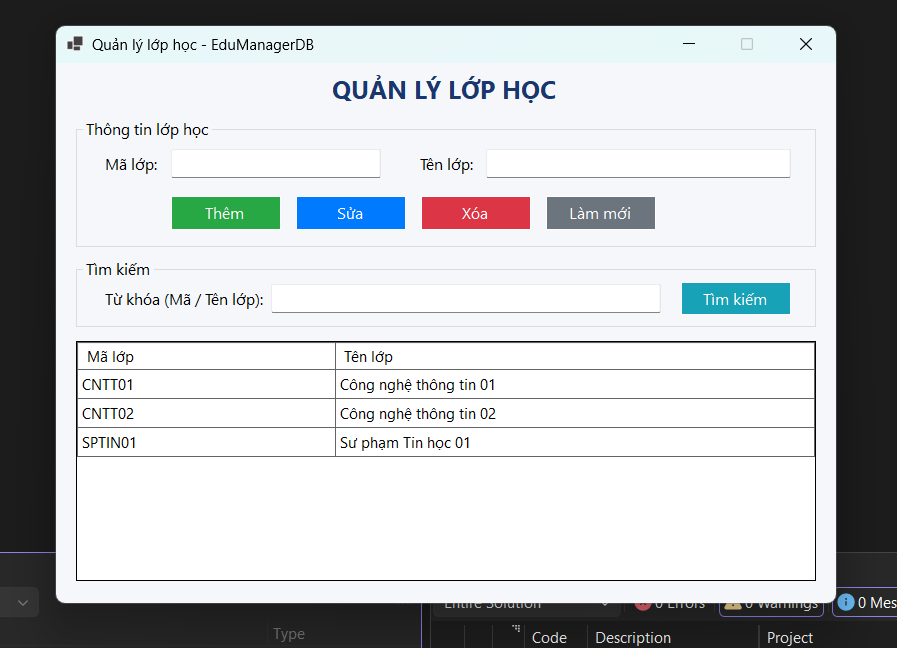
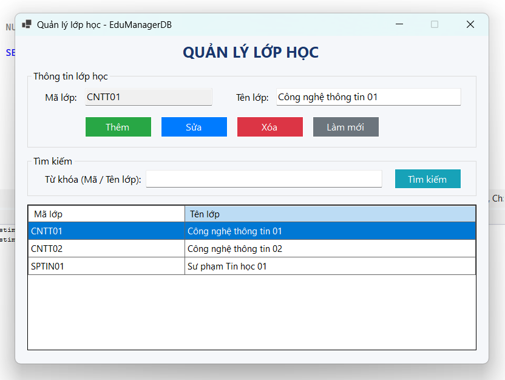
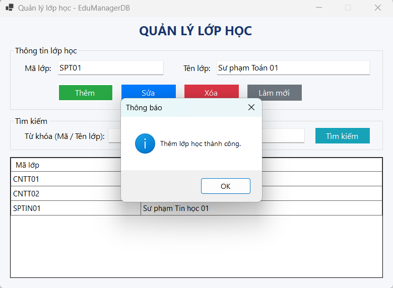
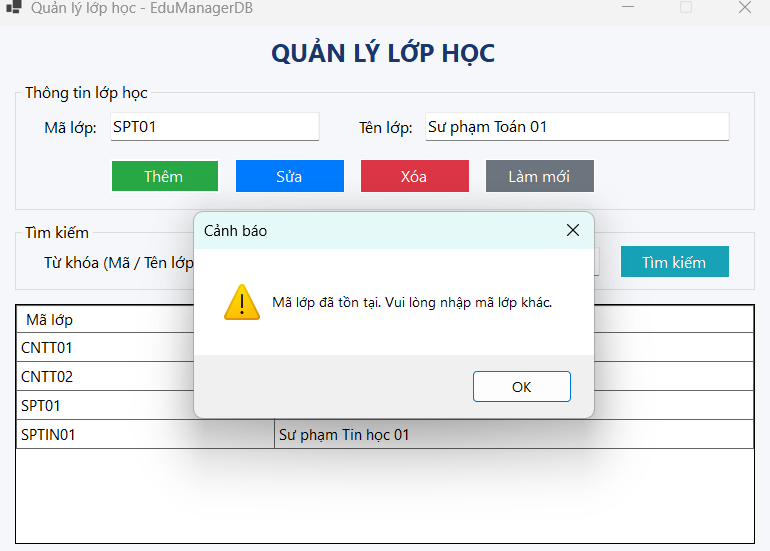
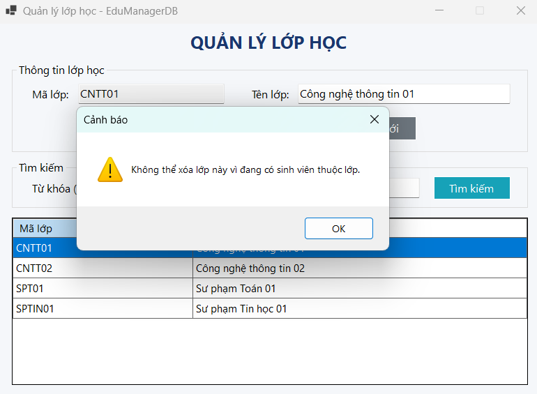
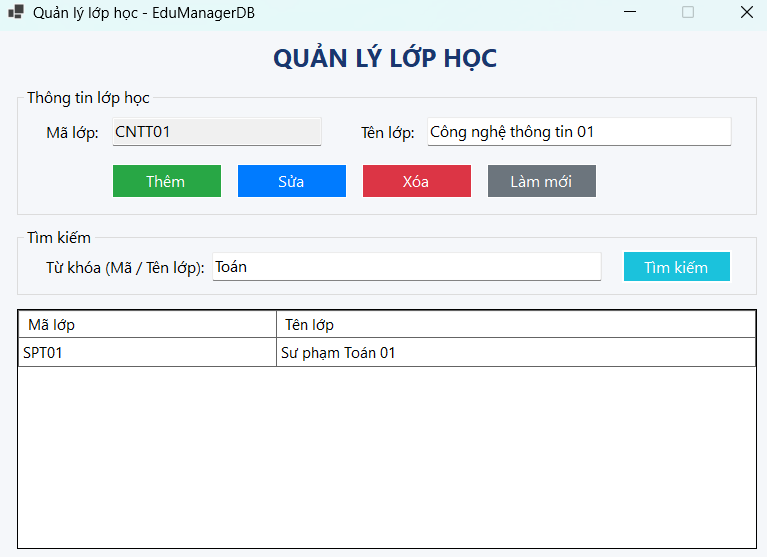

# BÁO CÁO THỰC HÀNH LAB 11: ADO.NET VÀ CRUD VỚI SQL SERVER

* **Học phần:** COMP1019 - Lập trình trên Windows
* **Giảng viên hướng dẫn:** ThS. Lê Thanh Thoại
* **Sinh viên thực hiện:** Ngô Minh Hải
* **Môi trường:** Visual Studio (C# WinForms, .NET 8.0), SQL Server, SSMS, `Microsoft.Data.SqlClient`
* **Cơ sở dữ liệu:** `EduManagerDB`

---

## 1. Cấu hình kết nối và Cấu trúc tệp

- **Chuỗi kết nối (Connection String):**
  ```csharp
  Data Source=localhost\SQLEXPRESS;Initial Catalog=EduManagerDB;Integrated Security=True;TrustServerCertificate=True;
  ```
- **Cấu trúc nộp bài:**
  - `EduManagerDB.sql`: Script tạo database `EduManagerDB`, bảng `LOP`, `SINHVIEN` và dữ liệu mẫu.
  - `Lab11_QuanLyLopHoc.sln`: Solution ứng dụng quản lý lớp học.
  - `Lab11_QuanLyLopHoc/`: Mã nguồn Form và giao diện (`FrmQuanLyLop.cs`, `FrmQuanLyLop.Designer.cs`).
  - `Images/`: 6 ảnh chụp màn hình kiểm thử chức năng.

---

## 2. Đặc tả chức năng và Xử lý kỹ thuật (F1 - F8)

| Mã | Chức năng | Cơ chế kỹ thuật |
| :---: | :--- | :--- |
| **F1** | Load dữ liệu | Sự kiện `Load` dùng `SqlDataAdapter` lấy dữ liệu từ bảng `LOP` hiển thị lên `dgvLop`. |
| **F2** | Chọn dòng | Click dòng trên `dgvLop` đổ dữ liệu lên `txtMaLop`, `txtTenLop`; khóa `txtMaLop` (`ReadOnly = true`). |
| **F3** | Thêm lớp | Kiểm tra rỗng, kiểm tra trùng khóa chính qua `ExecuteScalar`; thêm bằng `INSERT` có tham số. |
| **F4** | Sửa lớp | Kiểm tra trạng thái đã chọn dòng; cập nhật `TenLop` theo `MaLop` bằng lệnh `UPDATE`. |
| **F5** | Xóa lớp | Kiểm tra lớp có sinh viên ở bảng `SINHVIEN` (`COUNT > 0`), hỏi xác nhận (`Yes/No`) trước khi xóa; bắt lỗi khóa ngoại (SqlException 547). |
| **F6** | Tìm kiếm | Tìm kiếm gần đúng bằng `LIKE @TuKhoa` theo cả mã lớp và tên lớp. |
| **F7** | Làm mới | Xóa các ô nhập, mở khóa `txtMaLop` (`ReadOnly = false`) và load lại danh sách lớp. |
| **F8** | An toàn SQL | 100% câu lệnh SQL nhận dữ liệu người dùng đều dùng `SqlParameter`, chống SQL Injection. |

---

## 3. Ảnh chụp minh chứng kiểm thử

### 3.1. Kết nối và tải dữ liệu ban đầu (F1)
Khởi chạy ứng dụng, dữ liệu từ SQL Server hiển thị đầy đủ lên `DataGridView`:


### 3.2. Chọn dòng hiển thị thông tin lên Form (F2)
Click dòng trên lưới, thông tin đổ lên TextBox và khóa trường mã lớp:


### 3.3. Thêm mới bản ghi thành công (F3, F8)
Thêm lớp học mới với câu lệnh có tham số, lưới dữ liệu tự động cập nhật:


### 3.4. Kiểm tra ràng buộc trùng mã lớp (Validation)
Bắt lỗi và thông báo khi người dùng nhập mã lớp đã tồn tại trong CSDL:


### 3.5. Kiểm soát toàn vẹn khóa ngoại khi xóa (F5)
Ngăn chặn xóa lớp đang có sinh viên tham chiếu và xuất cảnh báo:


### 3.6. Tìm kiếm dữ liệu với LIKE và SqlParameter (F6)
Lọc danh sách lớp theo từ khóa gần đúng:


---

## 4. Hướng dẫn chạy chương trình

1. Chạy file `EduManagerDB.sql` trong SSMS bằng phím `F5` để khởi tạo database.
2. Mở file `Lab11_QuanLyLopHoc.sln` bằng Visual Studio.
3. Nhấn `Ctrl + Shift + B` để biên dịch và `F5` để chạy chương trình.
