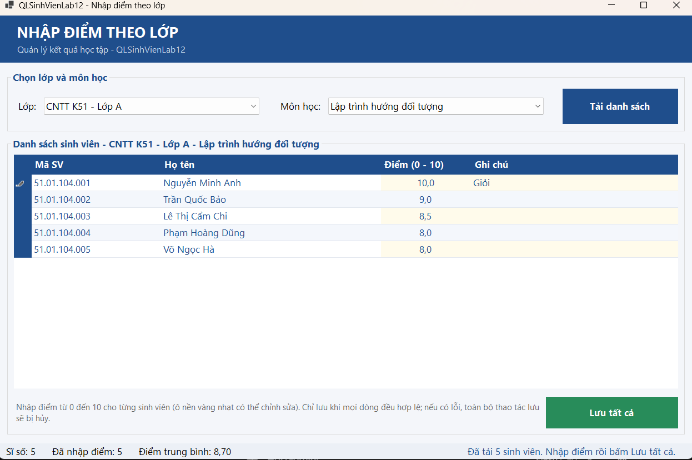
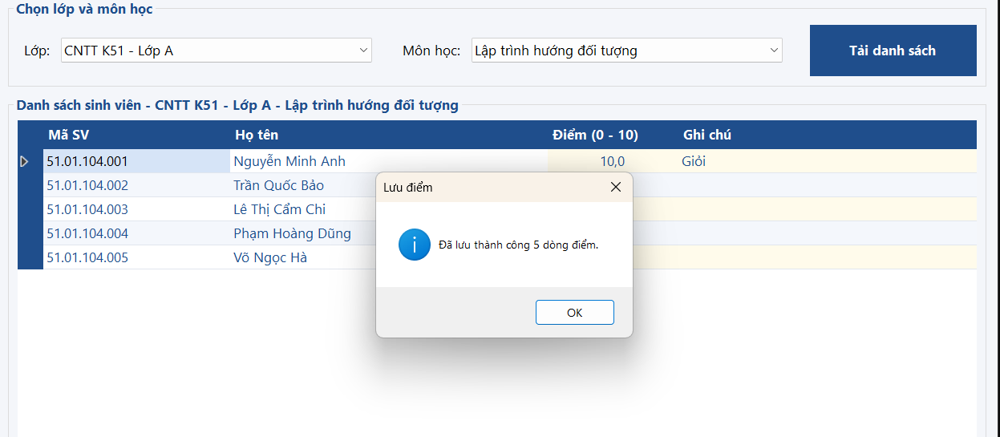
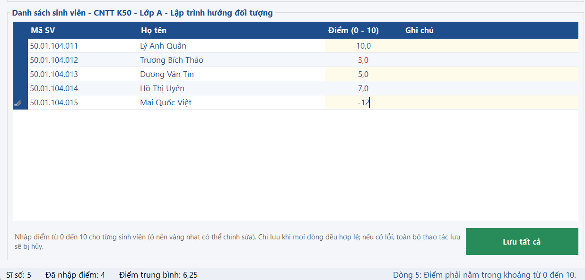
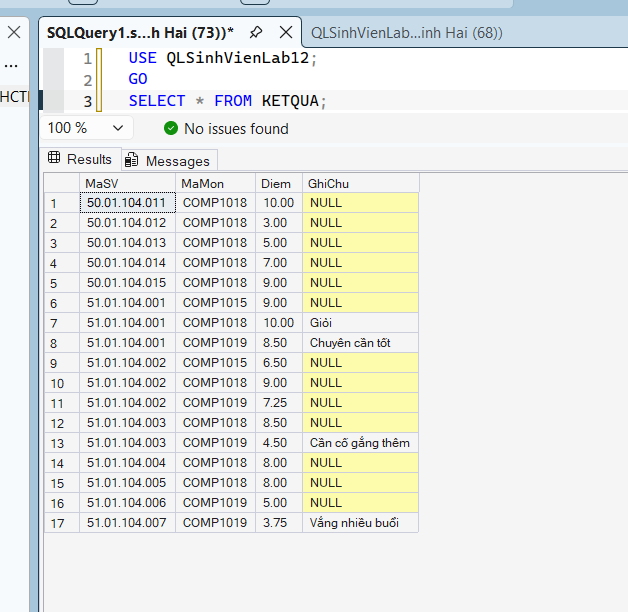

# BÁO CÁO THỰC HÀNH LAB 12: DATA BINDING, STORED PROCEDURE VÀ TRANSACTION

* **Học phần:** COMP1019 - Lập trình trên Windows
* **Giảng viên hướng dẫn:** ThS. Lê Thanh Thoại
* **Sinh viên thực hiện:** Ngô Minh Hải
* **Môi trường phát triển:** Microsoft Visual Studio (C# WinForms, .NET 8.0) & Microsoft SQL Server (SSMS)
* **Thư viện kết nối:** `Microsoft.Data.SqlClient`
* **Cơ sở dữ liệu:** `QLSinhVienLab12`

---

## 1. Cấu trúc Dự án (Project Organization)

Dự án áp dụng mô hình phân tách tầng truy cập dữ liệu (Data Access Layer - DAL) nhằm cô lập nghiệp vụ CSDL, tuân thủ nguyên tắc Clear Code:

```text
QLSinhVienLab12/
│
├── QLSinhVienLab12.sln                  # Solution dự án Visual Studio
├── README.md                            # Tài liệu báo cáo kỹ thuật chi tiết
│
├── Database/
│   └── QLSinhVienLab12.sql              # Script DDL, DML, ràng buộc và 4 Stored Procedures
│
├── Images/                              # Thư mục chứa 5 ảnh chụp minh chứng thực nghiệm
│   ├── 01_DataBinding_TaiDanhSach.png
│   ├── 02_TruocKhiLuu_NhapDiem.png
│   ├── 03_SauKhiLuu_CommitThanhCong.png
│   ├── 04_Validation_RollbackKhiLoi.png
│   └── 05_KiemTra_Database_SSMS.png
│
└── QLSinhVienLab12/
    ├── Program.cs                       # Điểm khởi chạy ứng dụng
    │
    ├── DAL/                             # Tầng truy xuất dữ liệu (Data Access Layer)
    │   ├── Database.cs                  # Quản lý cấu hình ConnectionString & tạo kết nối
    │   └── KetQuaDAL.cs                 # Xử lý Stored Procedure, DataTable & SqlTransaction
    │
    └── Forms/                           # Giao diện người dùng (Presentation Layer)
        ├── FrmNhapDiemTheoLop.cs        # Xử lý sự kiện UI, DataBinding, điều phối Transaction
        └── FrmNhapDiemTheoLop.Designer.cs
```

---

## 2. Thiết kế CSDL & Stored Procedures

### 2.1. Cấu trúc Bảng & Ràng buộc toàn vẹn

| Tên bảng | Khóa chính (PK) | Khóa ngoại (FK) | Ràng buộc kiểm tra (CHECK) | Ghi chú |
| :--- | :--- | :--- | :--- | :--- |
| `LOP` | `MaLop` | Không | Không | Quản lý danh mục lớp |
| `SINHVIEN` | `MaSV` | `MaLop` $\rightarrow$ `LOP(MaLop)` | Không | Quản lý hồ sơ sinh viên |
| `MONHOC` | `MaMon` | Không | `SoTinChi > 0` | Danh mục môn học |
| `KETQUA` | `(MaSV, MaMon)` | `MaSV` $\rightarrow$ `SINHVIEN(MaSV)`<br>`MaMon` $\rightarrow$ `MONHOC(MaMon)` | `$0 \le \text{Diem} \le 10$` | Lưu kết quả và điểm học tập |

### 2.2. Danh sách 4 Stored Procedure bắt buộc

1. **`sp_Lop_GetAll`**: Truy vấn danh sách lớp (`MaLop`, `TenLop`) để bind vào `cboLop`.
2. **`sp_MonHoc_GetAll`**: Truy vấn danh mục môn học (`MaMon`, `TenMon`) để bind vào `cboMonHoc`.
3. **`sp_KetQua_GetByLopMon`**: Nhận `@MaLop` và `@MaMon`, thực thi `LEFT JOIN` giữa `SINHVIEN` và `KETQUA` để lấy toàn bộ sinh viên thuộc lớp kèm điểm (nếu đã có).
4. **`sp_KetQua_Save`**: Nhận `@MaSV`, `@MaMon`, `@Diem`, `@GhiChu`. Thực thi cơ chế Upsert (kiểm tra `IF EXISTS` $\rightarrow$ `UPDATE`, ngược lại `INSERT`).

---

## 3. Đặc tả Thành phần Giao diện (Controls)

| Tên Control | Kiểu Control | Chức năng kỹ thuật |
| :--- | :--- | :--- |
| `cboLop` | `ComboBox` | Data Binding nguồn dữ liệu lớp học (`DisplayMember = "TenLop"`, `ValueMember = "MaLop"`) |
| `cboMonHoc` | `ComboBox` | Data Binding nguồn dữ liệu môn học (`DisplayMember = "TenMon"`, `ValueMember = "MaMon"`) |
| `btnTaiDanhSach` | `Button` | Tải dữ liệu sinh viên theo cặp Lớp - Môn học và nạp vào DataGridView qua BindingSource |
| `dgvKetQua` | `DataGridView` | Hiển thị 4 cột: `MaSV` (ReadOnly), `HoTen` (ReadOnly), `Diem` (Editable), `GhiChu` (Editable) |
| `btnLuuTatCa` | `Button` | Duyệt qua danh sách, kiểm tra dữ liệu và thực thi lưu hàng loạt bằng Transaction |
| `statusStrip1` / `tsslTrangThai` | `StatusStrip` | Hiển thị thông báo trạng thái thao tác, số dòng đã lưu hoặc thông tin lỗi thời gian thực |

---

## 4. Cơ chế Kỹ thuật Cốt lõi

### 4.1. Data Binding đồng bộ ComboBox & DataGridView
Khi mở Form, dữ liệu danh mục được đổ vào `DataTable` qua `SqlDataAdapter`, sau đó gán trực tiếp vào thuộc tính `DataSource` của `cboLop` và `cboMonHoc`. Lưới `dgvKetQua` liên kết thông qua đối tượng `BindingSource`, bảo đảm tự động phản hồi dữ liệu hai chiều (Two-way Binding) khi người dùng chỉnh sửa trực tiếp trên cell.

### 4.2. Quản lý Giao dịch Nguyên tử (Atomic SqlTransaction)
Thao tác lưu điểm hàng loạt áp dụng nguyên lý **ACID (All or Nothing)**:
* Khởi tạo transaction: `SqlTransaction tran = conn.BeginTransaction()`.
* Khi gọi Stored Procedure `sp_KetQua_Save`, gán `cmd.Transaction = tran`.
* **Commit:** Nếu toàn bộ danh sách sinh viên đều lưu thành công, thực thi `tran.Commit()` và cập nhật giao diện.
* **Rollback:** Nếu phát hiện bất kỳ dòng nào không hợp lệ (lỗi validation hoặc lỗi database), lập tức kích hoạt `tran.Rollback()`, hủy bỏ toàn bộ thay đổi trước đó, giữ toàn vẹn dữ liệu.

### 4.3. Quy tắc Validation dữ liệu đầu vào
Trước khi ghi xuống CSDL, từng dòng trên `dgvKetQua` được kiểm soát chặt chẽ:
* Điểm không được để trống (bắt buộc nhập giá trị).
* Điểm phải là định dạng số thực hợp lệ (`double.TryParse`).
* Điểm phải thỏa mãn miền giá trị quy định: $0 \le \text{Diem} \le 10$.

---

## 5. Minh chứng Thực nghiệm và Kiểm thử

| Mã TC | Kịch bản kiểm thử | Thao tác thực hiện | Kết quả mong đợi | Trạng thái |
| :---: | :--- | :--- | :--- | :---: |
| **TC01** | Data Binding & Tải dữ liệu | Chọn lớp `CNTT01`, môn `Lập trình trên Windows` $\rightarrow$ Bấm **Tải danh sách** | ComboBox load đúng CSDL; DataGridView hiển thị đủ danh sách SV của lớp | **PASS** |
| **TC02** | Nhập/chỉnh sửa điểm | Nhập điểm hợp lệ ($8.5, 9.0, 7.5$) và ghi chú cho sinh viên trên lưới | Các ô trên DataGridView nhận giá trị, sẵn sàng lưu | **PASS** |
| **TC03** | Lưu nhiều dòng thành công | Nhấn **Lưu tất cả** khi toàn bộ dữ liệu hợp lệ | Transaction Commit thành công; thông báo số lượng dòng đã lưu | **PASS** |
| **TC04** | Bẫy lỗi & Transaction Rollback | Nhập điểm không hợp lệ (ví dụ: $15.0$ hoặc chữ) $\rightarrow$ Nhấn **Lưu tất cả** | Báo lỗi chi tiết dòng sai; Rollback toàn bộ giao dịch, không lưu dữ liệu lỗi | **PASS** |
| **TC05** | Đối soát CSDL trên SSMS | Mở SSMS, truy vấn bảng `KETQUA` | Dữ liệu điểm và ghi chú trong CSDL trùng khớp 100% với form WinForms | **PASS** |

### 5.1. Nạp dữ liệu vào ComboBox và DataGridView qua Data Binding
Khởi chạy form, nạp danh mục lớp, môn học và hiển thị danh sách sinh viên lên DataGridView:


### 5.2. Form trước khi thực hiện thao tác lưu điểm
Người dùng nhập và cập nhật điểm, ghi chú trực tiếp trên các dòng của `dgvKetQua`:


### 5.3. Lưu hàng loạt dữ liệu thành công qua Transaction Commit
Sau khi nhấn nút "Lưu tất cả", toàn bộ dữ liệu được commit bền vững vào CSDL và xuất thông báo xác nhận:


### 5.4. Cơ chế Validation và Rollback Transaction khi phát hiện lỗi
Khi có dòng nhập điểm vượt ngoài khoảng từ 0 đến 10, hệ thống cảnh báo và hủy bỏ toàn bộ thao tác lưu:


### 5.5. Kiểm tra tính toàn vẹn dữ liệu trực tiếp trong SQL Server (SSMS)
Thực thi truy vấn `SELECT` trên SSMS để chứng minh dữ liệu đã được ghi nhận chuẩn xác vào bảng `KETQUA`:


---

## 6. Hướng dẫn Cài đặt & Chạy Ứng dụng

1. **Khởi tạo Cơ sở dữ liệu:**
   * Khởi động **SQL Server Management Studio (SSMS)**.
   * Mở tệp script `Database/QLSinhVienLab12.sql` và nhấn **F5** để tạo database `QLSinhVienLab12`, các bảng, dữ liệu mẫu và 4 stored procedures.
2. **Cấu hình Kết nối trong Visual Studio:**
   * Mở file solution `QLSinhVienLab12.sln`.
   * Kiểm tra chuỗi kết nối trong file `DAL/Database.cs` cho khớp với tên instance SQL Server cục bộ (mặc định: `localhost\SQLEXPRESS` hoặc `.`).
3. **Biên dịch & Thực thi:**
   * Nhấn `Ctrl + Shift + B` để build dự án.
   * Nhấn `F5` để khởi chạy ứng dụng và tiến hành nhập điểm.