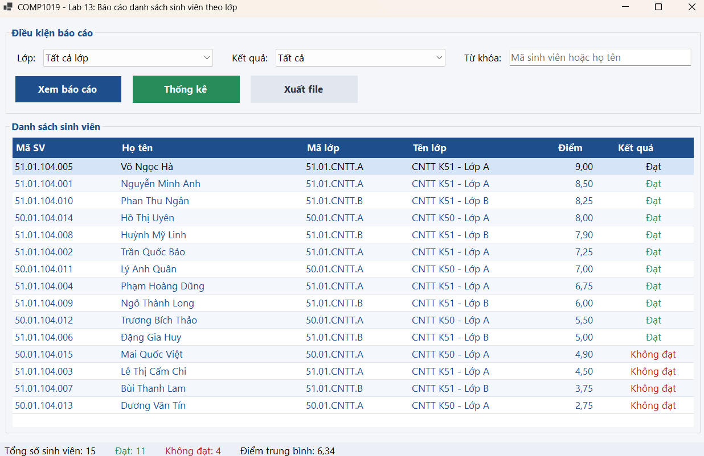
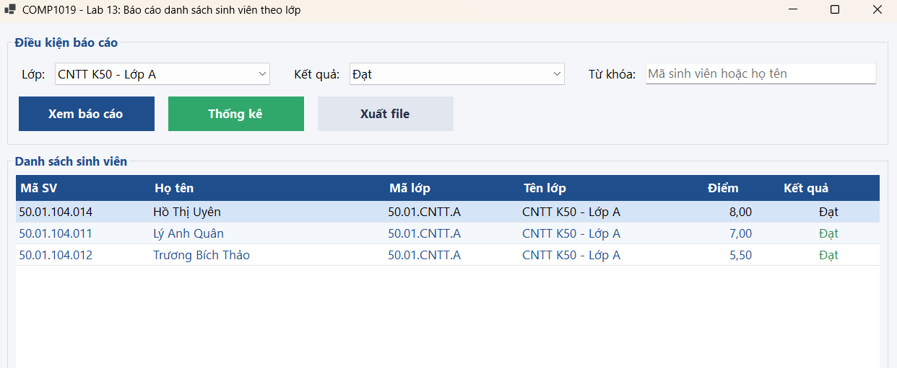
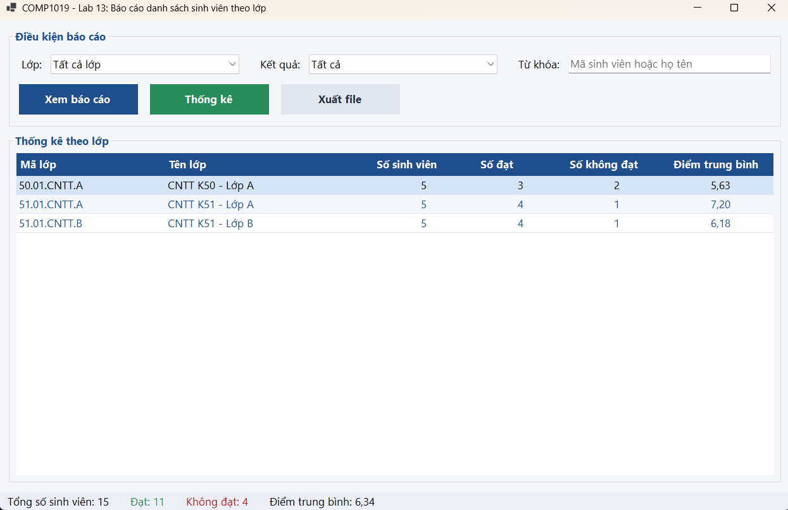
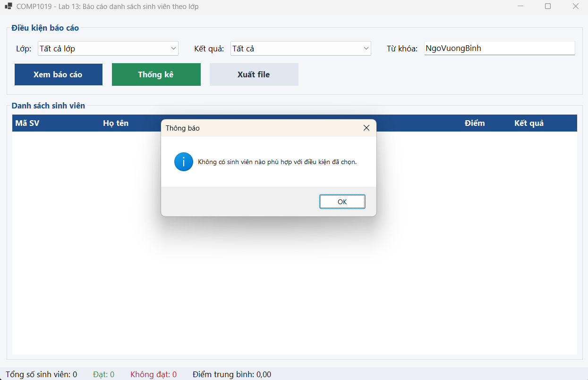
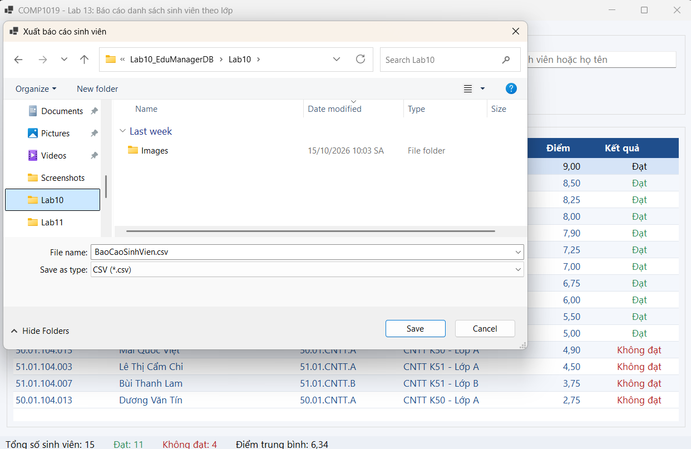

# BÁO CÁO THỰC HÀNH LAB 13: BÁO CÁO SINH VIÊN BẰNG LINQ

* **Học phần:** COMP1019 - Lập trình trên Windows
* **Giảng viên hướng dẫn:** ThS. Lê Thanh Thoại
* **Sinh viên thực hiện:** Ngô Minh Hải
* **Môi trường phát triển:** Microsoft Visual Studio (C# WinForms - .NET 8.0)
* **Công nghệ cốt lõi:** LINQ to Objects, DataGridView, SaveFileDialog, File I/O (Stream/UTF-8 Encoding)
* **Tên Solution:** `StudentReportDemo.sln`

---

## 1. Cấu trúc Thư mục và Phân bổ Tệp tin

Dự án được phân tầng theo cấu trúc hướng đối tượng chuẩn được gợi ý trong đề bài:

```text
StudentReportDemo/
│
├── StudentReportDemo.sln                # File Solution quản lý dự án
├── BaoCaoSinhVien.csv                   # Minh chứng file báo cáo CSV xuất từ ứng dụng
├── BaoCaoSinhVien.txt                   # Minh chứng file báo cáo TXT (phân cách bằng Tab)
├── README.md                            # Tài liệu báo cáo kỹ thuật hoàn chỉnh
│
├── Images/                              # Thư mục chứa 5 ảnh chụp màn hình kiểm thử
│   ├── 01_KhoiTao.png
│   ├── 02_LocDuLieu.png
│   ├── 03_ThongKe.png
│   ├── 04_ThongBao_KhongCoDuLieu.png
│   └── 05_XuatFile.png
│
└── StudentReportDemo/
    ├── StudentReportDemo.csproj         # Cấu hình dự án C# WinForms .NET 8.0
    ├── Program.cs                       # Điểm khởi chạy ứng dụng (Main)
    │
    ├── Models/
    │   └── SinhVien.cs                  # Lớp đối tượng thực thể SinhVien
    │
    └── Forms/
        ├── FrmBaoCaoSinhVien.cs         # Code-behind xử lý logic LINQ và sự kiện UI
        └── FrmBaoCaoSinhVien.Designer.cs # Định nghĩa và thiết kế trực quan giao diện
```

---

## 2. Thiết kế Lớp Thực thể (Model) và Bộ Dữ liệu Mẫu

### 2.1. Cấu trúc lớp `SinhVien` (`Models/SinhVien.cs`)
Lớp thực thể mô tả thông tin hồ sơ sinh viên với tính đóng gói và thuộc tính tính toán chỉ đọc:

| Tên thuộc tính | Kiểu dữ liệu | Đặc tả chức năng |
| :--- | :--- | :--- |
| `MaSV` | `string` | Mã định danh sinh viên (Ví dụ: `SV001`, `SV002`,...) |
| `HoTen` | `string` | Họ và tên đầy đủ của sinh viên |
| `MaLop` | `string` | Mã lớp sinh hoạt (`CNTT01`, `CNTT02`, `SPTIN01`) |
| `TenLop` | `string` | Tên diễn giải đầy đủ của lớp học |
| `Diem` | `double` | Điểm trung bình tích lũy học tập |
| `KetQua` | `string` *(read-only)* | Biểu thức điều kiện: Trả về `"Đạt"` nếu $Diem \ge 5.0$, ngược lại `"Không đạt"` |

### 2.2. Bộ dữ liệu mẫu (`TaoDuLieuMau`)
* **Quy mô danh sách:** Khởi tạo danh sách gồm **15 sinh viên** (vượt yêu cầu tối thiểu 12 sinh viên của đề bài), phân bổ đều vào **3 lớp** (`CNTT01`, `CNTT02`, `SPTIN01`).
* **Phân bố kết quả:** Điểm số trải rộng từ $3.8$ đến $9.4$, bảo đảm đầy đủ các trường hợp kiểm thử cho cả kết quả "Đạt" (11 sinh viên) và "Không đạt" (4 sinh viên).

---

## 3. Đặc tả Danh mục Thành phần Điều khiển (Controls)

| Nhóm chức năng | Tên Control | Kiểu Control | Chức năng chi tiết |
| :--- | :--- | :--- | :--- |
| **Tiêu đề** | `lblTitle` | `Label` | Tiêu đề báo cáo ứng dụng |
| **Bộ lọc** | `cboLop` | `ComboBox` | Danh sách chọn lớp: gồm `"Tất cả"` và các mã lớp duy nhất |
| | `cboKetQua` | `ComboBox` | Điều kiện kết quả học tập: `"Tất cả"`, `"Đạt"`, `"Không đạt"` |
| | `txtTuKhoa` | `TextBox` | Nhập từ khóa tra cứu gần đúng theo mã hoặc họ tên |
| **Thao tác** | `btnXemBaoCao` | `Button` | Thực thi LINQ lọc và sắp xếp giảm dần theo điểm |
| | `btnThongKe` | `Button` | Thực thi LINQ gom nhóm thống kê số lượng và điểm TB lớp |
| | `btnXuatFile` | `Button` | Kích hoạt `SaveFileDialog` xuất dữ liệu ra file CSV/TXT |
| **Bảng hiển thị** | `dgvBaoCao` | `DataGridView` | Hiển thị danh sách chi tiết hoặc kết quả thống kê |
| **Thống kê nhanh** | `pnlThongKeNhanh` | `Panel` | Panel hiển thị trực quan 4 chỉ số thống kê tổng hợp |
| | `statusStrip1` | `StatusStrip` | Thanh trạng thái đáy form hiển thị thông số chi tiết |

---

## 4. Tổ chức Mã nguồn và Kỹ thuật Xử lý LINQ

Mã nguồn được phân tách rõ ràng thành các hàm chức năng độc lập theo yêu cầu tổ chức code:

### 4.1. Nạp danh mục lựa chọn (`LoadComboBox`)
Sử dụng toán tử LINQ truy vấn danh sách mã lớp không trùng lặp và sắp xếp theo thứ tự chữ cái:
```csharp
var danhSachLop = _danhSachSinhVien
    .Select(sv => sv.MaLop)
    .Distinct()
    .OrderBy(maLop => maLop)
    .ToList();

danhSachLop.Insert(0, "Tất cả");
cboLop.DataSource = danhSachLop;
```

### 4.2. Lọc dữ liệu kết hợp đa điều kiện & Sắp xếp giảm dần (`XemBaoCao`)
Áp dụng cơ chế truy vấn trì hoãn (Deferred Execution) của `IEnumerable<T>` để nối tầng các điều kiện lọc linh hoạt, sau đó dùng `OrderByDescending` theo điểm:
```csharp
var truyVan = _danhSachSinhVien.AsEnumerable();

if (lopChon != "Tất cả")
    truyVan = truyVan.Where(sv => sv.MaLop == lopChon);

if (ketQuaChon != "Tất cả")
    truyVan = truyVan.Where(sv => sv.KetQua == ketQuaChon);

if (!string.IsNullOrEmpty(tuKhoa))
{
    truyVan = truyVan.Where(sv =>
        sv.MaSV.Contains(tuKhoa, StringComparison.OrdinalIgnoreCase) ||
        sv.HoTen.Contains(tuKhoa, StringComparison.OrdinalIgnoreCase));
}

var ketQuaLoc = truyVan
    .OrderByDescending(sv => sv.Diem)
    .ThenBy(sv => sv.MaSV)
    .ToList();
```

### 4.3. Gom nhóm và Thống kê theo từng Lớp (`ThongKeTheoLop`)
Sử dụng toán tử `GroupBy` với kiểu ẩn danh đa trường (Composite Key) kết hợp các hàm tổng hợp `Count` và `Average`:
```csharp
var thongKeLop = _danhSachSinhVien
    .GroupBy(sv => new { sv.MaLop, sv.TenLop })
    .Select(nhom => new
    {
        MaLop = nhom.Key.MaLop,
        TenLop = nhom.Key.TenLop,
        SoLuongSV = nhom.Count(),
        SoDat = nhom.Count(sv => sv.KetQua == "Đạt"),
        SoKhongDat = nhom.Count(sv => sv.KetQua == "Không đạt"),
        DiemTrungBinh = Math.Round(nhom.Average(sv => sv.Diem), 2)
    })
    .OrderByDescending(tk => tk.DiemTrungBinh)
    .ToList();
```

### 4.4. Cơ chế Xuất báo cáo an toàn (`XuatFile`)
* Hỗ trợ xuất 2 định dạng: **CSV (Comma-Separated Values)** tương thích Excel và **TXT (Tab-Delimited)** mở dễ dàng trên Notepad.
* Tự động bao bọc dấu ngoặc kép `""` cho trường hợp giá trị chứa ký tự đặc biệt (dấu phẩy, xuống dòng).
* Toàn bộ thao tác ghi file được bọc trong khối `try...catch` để xử lý ngoại lệ truy cập tệp.
* Lưu file dưới chuẩn bảng mã **UTF-8 có BOM** (`new UTF8Encoding(true)`) nhằm bảo toàn chữ tiếng Việt có dấu.

---

## 5. Minh chứng Thực nghiệm và Bảng Kiểm thử

Bảng đối soát 5 ca kiểm thử chức năng tương ứng với bộ ảnh thực tế trong thư mục `Images`:

| STT | Kịch bản kiểm thử | Thao tác thực hiện | Kết quả mong đợi | Trạng thái |
| :---: | :--- | :--- | :--- | :---: |
| **TC01** | Khởi tạo giao diện ban đầu | Mở ứng dụng | Tải đủ 15 SV, sắp xếp điểm giảm dần, nạp danh mục ComboBox, hiển thị đúng các chỉ số thống kê. | **PASS** |
| **TC02** | Lọc dữ liệu kết hợp bằng LINQ | Chọn lớp, chọn kết quả học tập $\rightarrow$ Bấm Xem báo cáo | Bảng lọc đúng danh sách thỏa mãn đồng thời các tiêu chí; sắp xếp giảm dần theo điểm. | **PASS** |
| **TC03** | Thống kê dữ liệu theo lớp | Bấm nút Thống kê | Lưới chuyển sang hiển thị bảng tổng hợp: Số lượng SV, Số đạt, Số không đạt, Điểm TB từng lớp. | **PASS** |
| **TC04** | Xử lý khi không có dữ liệu | Nhập từ khóa không tồn tại $\rightarrow$ Bấm Xem báo cáo | Hiển thị hộp thoại cảnh báo thông báo rõ ràng cho người dùng, không gây crash chương trình. | **PASS** |
| **TC05** | Xuất báo cáo ra file văn bản | Bấm Xuất file $\rightarrow$ Chọn vị trí lưu tệp CSV/TXT | Xuất thành công tệp dữ liệu kèm dòng tổng kết chỉ số; hiển thị hộp thoại kèm đường dẫn file. | **PASS** |

### 5.1. Khởi tạo form và hiển thị dữ liệu ban đầu
Ngay khi mở ứng dụng, toàn bộ danh sách sinh viên được nạp lên `dgvBaoCao`, sắp xếp giảm dần theo điểm và các thanh thống kê hiển thị đầy đủ:


### 5.2. Lọc dữ liệu bằng LINQ và sắp xếp theo điểm
Lọc dữ liệu theo điều kiện kết hợp (Lớp học, Kết quả học tập hoặc Từ khóa), bảng tự động làm mới và các chỉ số thống kê được tính toán lại:


### 5.3. Thống kê số lượng và điểm trung bình theo từng lớp
Thực thi chức năng gom nhóm (`GroupBy`), DataGridView hiển thị bảng thống kê chi tiết theo từng lớp học:


### 5.4. Thông báo thân thiện khi không có dữ liệu phù hợp
Khi điều kiện tìm kiếm không có dữ liệu phù hợp, hệ thống kích hoạt hộp thoại cảnh báo người dùng:


### 5.5. Hộp thoại xuất file báo cáo thành công
Thao tác xuất báo cáo hoàn tất với hộp thoại thông báo chi tiết đường dẫn file lưu trữ:


---

## 6. Hướng dẫn Biên dịch và Sử dụng

1. **Môi trường yêu cầu:** Cài đặt **Visual Studio 2022** (.NET 8.0 SDK / Windows Forms Desktop).
2. **Biên dịch dự án:** Mở file `StudentReportDemo.sln`, nhấn tổ hợp phím `Ctrl + Shift + B` để build toàn bộ mã nguồn.
3. **Thực thi chương trình:** Nhấn `F5` để chạy ứng dụng:
   * Chọn tiêu chí lọc và bấm **Xem báo cáo** để lọc danh sách sinh viên.
   * Bấm **Thống kê** để xem bảng tổng hợp theo lớp học.
   * Bấm **Xuất file** để lưu kết quả báo cáo ra đĩa cứng dạng `.csv` hoặc `.txt`.